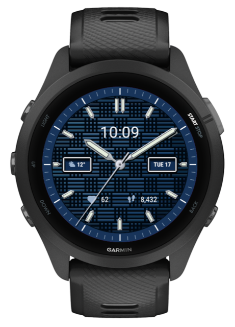
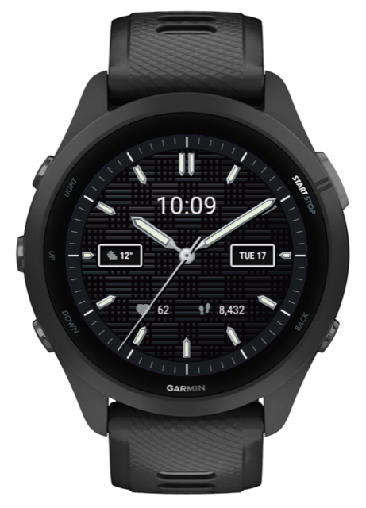
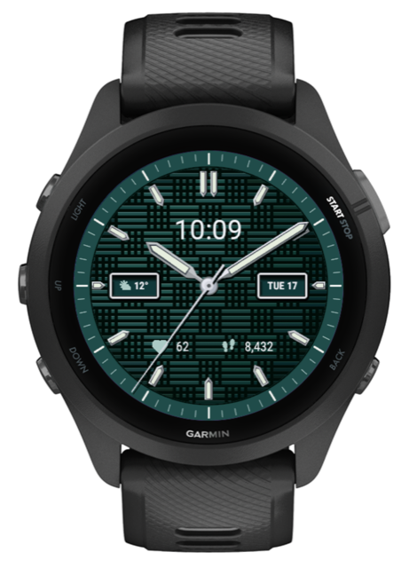
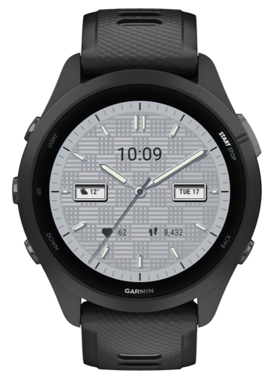
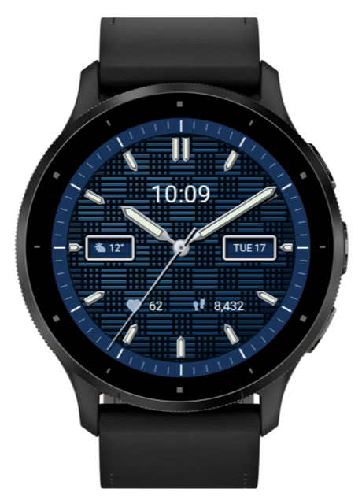
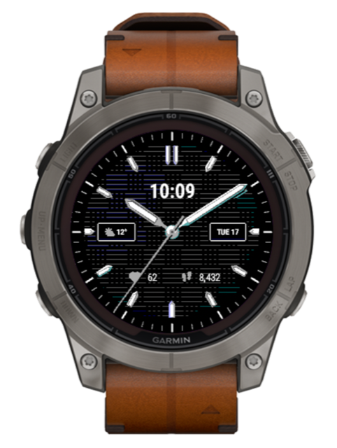
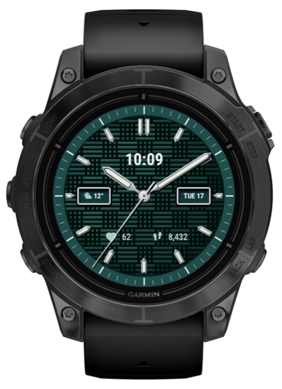

# Classic — Garmin watch face

An engineer's-watch style analogue face for Garmin (built and tested on the Forerunner 265):

- woven checkerboard dial texture with lighting and a rim shadow
- faceted steel hands and applied markers with lume inlays
- recessed day-date window (3 o'clock) and weather window (9 o'clock) in polished steel frames
- digital time, heart rate and steps
- dial colours: Black, Blue (default), Aqua, Silver; optional seconds hand
- low-power always-on mode for AMOLED watches (outlines only, burn-in shift)

## Screenshots
Real renders from the Connect IQ simulator (fixed 10:09 with sample data).

| Blue | Black | Aqua | Silver |
|:---:|:---:|:---:|:---:|
|  |  |  |  |
| Forerunner 265 | Forerunner 265 | Forerunner 265 | Forerunner 265 |

| Venu 3 | fēnix 7 Pro (MIP) | epix Pro 47 mm |
|:---:|:---:|:---:|
|  |  |  |

Preview the design in a browser: `open preview/face.html`

## Setup (one time)
1. Install the **Connect IQ SDK Manager**: https://developer.garmin.com/connect-iq/sdk/ —
   download the latest SDK and your device(s).
2. Generate a developer key (kept out of git — back it up, you need the same key for updates):
   ```sh
   openssl genrsa -out developer_key.pem 4096
   openssl pkcs8 -topk8 -inform PEM -outform DER -in developer_key.pem -out developer_key.der -nocrypt
   ```
3. For installing over USB: `brew install libmtp`

## Commands
```sh
make run                  # build + open in the simulator (Forerunner 265)
make run DEVICE=venu3     # any device listed in manifest.xml
make build                # just build bin/Classic.prg
make install              # build + copy to a USB-connected watch (GARMIN/Apps)
python3 tools/gen_icons.py  # regenerate the icon fonts after editing the icons
tools/screenshots.sh        # re-render screenshots/ from the simulator (device:dial args optional)
```
Zed users: the same commands are available as tasks (`.zed/tasks.json`).

After `make install`, unplug the watch and pick **Classic** from the watch-face list.

## Layout
- `source/ClassicFaceView.mc` — all drawing code (static layer cached in a buffered bitmap)
- `resources*/fonts/` — generated icon fonts per screen size
- `tools/gen_icons.py` — icon font generator (SDF-rendered, anti-aliased)
- `tools/install_to_watch.py` — MTP copy via libmtp
- `tools/screenshots.sh`, `demo.jungle` — screenshot build (demo time/data compiled in only there)
- `preview/face.html` — browser mock-up mirroring the watch code
